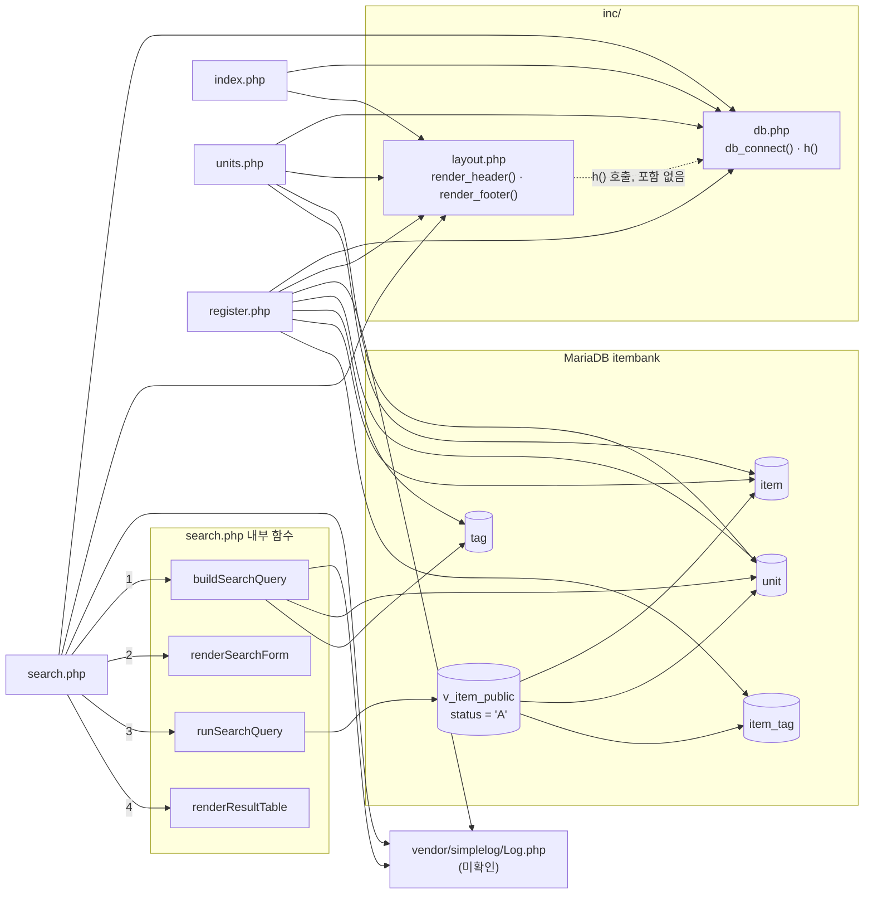

# legacy/item-bank-php 아키텍처

> 분석 범위: 진입점 · 의존 관계. 데이터 흐름 · 비즈니스 규칙은 아직 분석하지 않았다.
> 근거 표기는 `파일:줄번호` 이며, 경로가 없으면 `legacy/item-bank-php/` 기준이다.

## 1. 모듈 개요

- 문항 은행 웹 화면. PHP 7.4 + Apache 이미지(`Dockerfile:1`)에서 mysqli 로 MariaDB `itembank` 에 접속한다(`inc/db.php:16`, `:21`).
- 화면은 홈 · 단원 목록 · 문항 등록 · 문항 검색 4개이며 라우터 없이 URL 하나가 PHP 파일 하나에 대응한다.
- 모듈 전체가 `/var/www/html/` 로 복사되고(`Dockerfile:14`) 호스트 8081 → 컨테이너 80 으로 노출된다(`docker-compose.yml:39`).
- PHP 6개 파일 1,066줄 중 `search.php` 가 731줄이다.

## 2. 폴더 구조

```
legacy/item-bank-php/
├── Dockerfile          16줄  php:7.4-apache, mysqli 확장, rewrite 모듈
├── index.php           14줄  홈(메뉴)
├── units.php           48줄  단원 목록
├── register.php       177줄  문항 등록 (함수 없음, 최상위 절차 코드)
├── search.php         731줄  문항 검색 (함수 4개)
├── inc/
│   ├── db.php          37줄  db_connect(), h()
│   └── layout.php      43줄  render_header(), render_footer()
└── vendor/
    └── simplelog/Log.php     외부 로그 라이브러리 — 열지 않음
```

- `.htaccess` 는 없다. `a2enmod rewrite` 는 켜져 있으나(`Dockerfile:4`) rewrite 규칙은 없다.

## 3. 진입점

| URL / 화면 | 처음 실행되는 파일 | 부르는 주요 함수 (근거) |
|---|---|---|
| `/index.php` 홈(메뉴) | `index.php` | `render_header('홈')` `index.php:5`, `render_footer()` `index.php:14`. DB 조회 없음 |
| `/` | 미확인 | Apache DirectoryIndex 설정에 달려 있다. 이미지 설정은 열어 보지 않았다 |
| `/units.php` 단원 목록 | `units.php` | `render_header` `units.php:5`, `db_connect` `units.php:8`, `$conn->query` `units.php:20`, `h` `units.php:40-43`, `render_footer` `units.php:48` |
| `/register.php` GET: 등록 폼 | `register.php` | `db_connect` `register.php:17`, 단원 · 태그 목록 조회 `register.php:27`, `:34`, `render_header` `register.php:127`, `render_footer` `register.php:177` |
| `/register.php` POST: 저장 | `register.php` (POST 분기 `register.php:40`) | 검증 `register.php:49-81`, `begin_transaction` `:85`, `prepare`/`execute` `:92-111`, `commit` `:114`, `Log::info` `:115`, 실패 시 `rollback` `:120`, `Log::error` `:121` |
| `/search.php?q=&unit=&level=&tag=&sort=&dir=&page=` 문항 검색 (파라미터 설명 `search.php:5-12`) | `search.php` | `render_header` `search.php:709`, `db_connect` `:713`, `buildSearchQuery($_GET, $conn)` `:722`, `renderSearchForm` `:723`, `runSearchQuery` `:724`, `renderResultTable` `:725`, `Log::error` `:727` |

## 4. 의존 관계

### 4.1 흐름도

화살표는 "A → B (A가 B를 포함 · 호출)" 를 뜻한다. 점선은 선언된 포함 없이 생기는 숨은 의존이다. `search.php` 에서 내부 함수로 가는 화살표의 숫자는 호출 순서다(`search.php:722-725`).



### 4.2 파일 포함 (`require_once`)

| 포함하는 파일 | → inc/db.php | → inc/layout.php | → vendor/simplelog/Log.php |
|---|---|---|---|
| `index.php` | `index.php:2` | `index.php:3` | 없음 |
| `units.php` | `units.php:2` | `units.php:3` | 없음 |
| `register.php` | `register.php:2` | `register.php:3` | `register.php:4` (`use SimpleLog\Log` `:6`) |
| `search.php` | `search.php:20` | `search.php:21` | `search.php:22` (`use` `:24`) |

숨은 의존: `inc/layout.php` → `inc/db.php` 의 `h()`.
- `render_header` 가 `h()` 를 부르는데(`inc/layout.php:17`, `:33`), `h()` 는 `inc/db.php:34` 에 정의돼 있다.
- `layout.php` 는 `db.php` 를 포함하지 않는다. 따라서 페이지마다 db.php 를 layout.php 보다 먼저 포함해야 동작한다.

### 4.3 함수 호출

| 호출하는 쪽 | → 호출 대상 | 근거 |
|---|---|---|
| `index.php` | `render_header`, `render_footer` | `index.php:5`, `:14` |
| `index.php` | `db_connect` 호출 없음. db.php 는 `h()` 때문에만 필요 | `index.php:1-14` |
| `units.php` | `db_connect` | `units.php:8` |
| `units.php` | `h` | `units.php:10`, `:40-43` |
| `units.php` | `render_header`, `render_footer` | `units.php:5`, `:11`, `:23`, `:48` |
| `register.php` | `db_connect` | `register.php:17` |
| `register.php` | `render_header`, `render_footer` | `register.php:19`, `:127`, `:21`, `:177` |
| `register.php` | `h` | `register.php:20`, `:131-171` |
| `register.php` | `Log::info`, `Log::error` | `register.php:115`, `:121` |
| `search.php` 최상위 | `Log::setThreshold(Log::LEVEL_INFO)` | `search.php:27` |
| `search.php` 최상위 | `render_header`, `db_connect` | `search.php:709`, `:713` |
| `search.php` 최상위 | `buildSearchQuery` → `renderSearchForm` → `runSearchQuery` → `renderResultTable` | `search.php:722-725` |
| `search.php` 최상위 | `Log::error`, `render_footer` | `search.php:727`, `:717`, `:731` |
| `buildSearchQuery` | `h` | `search.php:360`, `:365`, `:416`, `:455-513` |
| `buildSearchQuery` | `Log::debug`, `Log::error` | `search.php:103`, `:528`, `:537` |
| `runSearchQuery` | mysqli `prepare` · `bind_param` · `execute` | `search.php:577-621` |
| `renderResultTable` | `h` | `search.php:674-678`, `:690-700` |

### 4.4 DB 객체 참조

| DB 객체 | 참조 위치 |
|---|---|
| `unit` | `units.php:16-19`, `register.php:27`, `search.php:125`, `:156` |
| `tag` | `register.php:34`, `search.php:178` |
| `item` | `units.php:17`, `register.php:87` (`MAX(id)+1 FOR UPDATE`), `register.php:93` (INSERT) |
| `item_tag` | `register.php:105` (INSERT), `search.php:244` |
| `v_item_public` | `search.php:522`, `:245`. 정의는 `db/mariadb/init/01-schema.sql:52-70` (`item ⨝ unit`, `WHERE i.status = 'A'`, 태그 이름 `GROUP_CONCAT`) |

### 4.5 화면 간 링크 (HTML)

| 출발 | → 도착 | 근거 |
|---|---|---|
| `inc/layout.php` 메뉴 | search · register · units | `inc/layout.php:10-12` |
| `inc/layout.php` 머리글 | index | `inc/layout.php:30` |
| `index.php` 메뉴 | search · register · units | `index.php:9-11` |
| `register.php` 폼 | 자기 자신 (POST) | `register.php:141` |
| `search.php` 폼 | 자기 자신 (GET) | `search.php:632` |

## 5. 가장 긴 함수 3개

| 순위 | 파일 · 함수 | 시작 ~ 끝 | 길이 | 하는 일 |
|---|---|---|---|---|
| 1 | `search.php` `buildSearchQuery` | `search.php:42` ~ `:564` | 523줄 | GET 파라미터로 검색 SQL · 바인딩 값을 조립하고, 폼 · 정렬 링크 · 페이지 링크 · 경고 HTML 까지 한 번에 만든다. 단원 · 태그 목록 DB 조회도 이 안에서 한다(`:125`, `:156`, `:178`) |
| 2 | `search.php` `renderResultTable` | `search.php:647` ~ `:704` | 58줄 | 경고 · 조건 요약 · 건수 · 결과 표 · 페이지 이동 링크를 출력한다 |
| 3 | `search.php` `runSearchQuery` | `search.php:571` ~ `:624` | 54줄 | 건수 SQL 과 페이지 SQL 을 prepared statement 로 실행해 `total`, `rows` 를 돌려준다 |

함수가 아닌 최상위 절차 코드까지 포함하면 `register.php:8-177` (약 170줄)이 두 번째로 길다.

## 6. 미확인 목록

| 항목 | 확인하지 못한 이유 |
|---|---|
| `/` 요청 시 `index.php` 가 실행되는지 | Apache DirectoryIndex 설정(베이스 이미지)을 열어 보지 않았다 |
| `SimpleLog\Log` 의 `debug` · `info` · `error` · `setThreshold` 동작 | 규칙상 `vendor/` 를 열지 않았다 |
| 로그가 어디에 쌓이는지 (파일 / stderr 등) | 위와 같음 |
| `register.php` 의 로그 임계값 | `setThreshold` 를 부르지 않는다. 기본값은 `vendor/` 안에 있어 확인하지 않았다 |
| `search.php:103`, `:528` 의 `Log::debug` 가 실제로 출력되는지 | 임계값이 INFO(`search.php:27`)이지만 레벨 비교 로직이 `vendor/` 안에 있다 |
