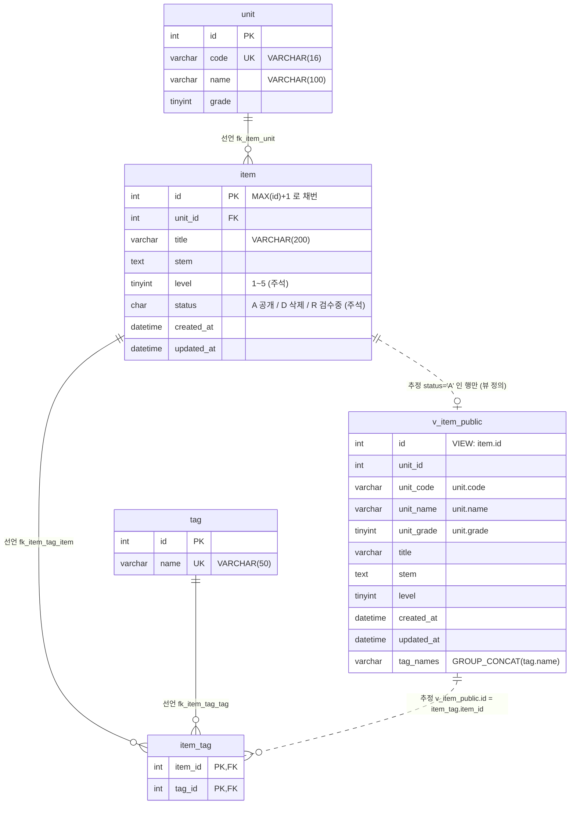
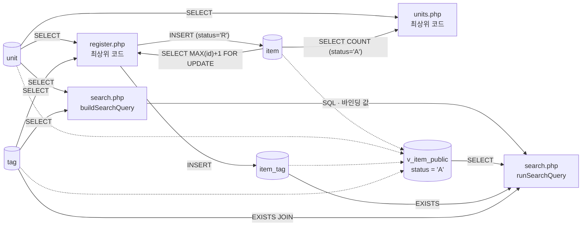

# legacy/item-bank-php 데이터 흐름 · ERD

> 분석 범위: `legacy/item-bank-php` 가 읽고 쓰는 테이블 · 뷰, 테이블 간 관계, 읽기 · 쓰기 위치.
> 진입점 · 파일 의존 관계는 [ARCHITECTURE.md](ARCHITECTURE.md) 를 본다.
> 근거 표기는 `파일:줄번호` 이다. 경로가 `db/` 로 시작하지 않으면 `legacy/item-bank-php/` 기준이다.
> `vendor/` 는 열지 않았다.

## 1. 테이블 목록

스키마는 `db/mariadb/init/01-schema.sql` 에 있고, DB 이름은 `itembank` 이다(`db/mariadb/init/01-schema.sql:5`, `inc/db.php:16`).

| 테이블 | 주요 컬럼 | 키 · 제약 | 근거 (스키마) | 근거 (PHP 코드의 SQL) |
|---|---|---|---|---|
| `unit` 단원 | `id` INT, `code` VARCHAR(16), `name` VARCHAR(100), `grade` TINYINT | PK `id`, UNIQUE `uk_unit_code(code)` | `db/mariadb/init/01-schema.sql:11-18` | `units.php:16-19`, `register.php:27`, `search.php:125`, `search.php:156` |
| `item` 문항 | `id` INT, `unit_id` INT, `title` VARCHAR(200), `stem` TEXT, `level` TINYINT(주석상 1~5), `status` CHAR(1) 기본 `'A'`(주석상 A=공개 D=삭제 R=검수중), `created_at` DATETIME, `updated_at` DATETIME | PK `id`(AUTO_INCREMENT 아님), KEY `idx_item_unit`, `idx_item_level`, FK `fk_item_unit` | `db/mariadb/init/01-schema.sql:20-33` | `units.php:17`, `register.php:87`, `register.php:92-94` |
| `tag` 태그 | `id` INT, `name` VARCHAR(50) | PK `id`, UNIQUE `uk_tag_name(name)` | `db/mariadb/init/01-schema.sql:35-40` | `register.php:34`, `search.php:178`, `search.php:244` |
| `item_tag` 문항↔태그 | `item_id` INT, `tag_id` INT | PK `(item_id, tag_id)`, FK `fk_item_tag_item`, `fk_item_tag_tag` | `db/mariadb/init/01-schema.sql:42-48` | `register.php:105`, `search.php:244-245` |
| `v_item_public` 뷰 (공개 문항) | `id`, `unit_id`, `unit_code`, `unit_name`, `unit_grade`, `title`, `stem`, `level`, `created_at`, `updated_at`, `tag_names`(태그 이름 `GROUP_CONCAT`, `t.id` 순, `,` 구분) | `item ⨝ unit`, `WHERE i.status = 'A'` | `db/mariadb/init/01-schema.sql:52-70` | `search.php:521-526`, `search.php:245` |

참고
- 같은 DB 에 `class` · `assignment` · `distribution` · `submission` 도 있지만(`db/mariadb/init/01-schema.sql:75-115`) `legacy/item-bank-php` 코드는 이 테이블들을 참조하지 않는다. 다만 `assignment.unit_id` → `unit.id` 외래 키(`db/mariadb/init/01-schema.sql:89`)가 있으므로 `unit` 을 바꾸면 과제 쪽에 영향이 간다.
- `item.status`, `item.level` 의 값 범위는 주석뿐이고 CHECK 제약은 없다(`db/mariadb/init/01-schema.sql:25-26`). 난이도 1~5 는 애플리케이션이 검증한다(`register.php:70`).

## 2. 테이블 관계

- 실선(`--`) = **선언**: 스키마에 외래 키로 선언된 관계.
- 점선(`..`) = **추정**: 외래 키는 없고 코드의 JOIN · WHERE 에서 추정한 관계.

| 관계 | 구분 | 근거 |
|---|---|---|
| `item.unit_id` → `unit.id` (N:1) | 선언 | FK `db/mariadb/init/01-schema.sql:32`. 코드 사용: 뷰 JOIN `db/mariadb/init/01-schema.sql:69`, 상관 서브쿼리 `units.php:17` |
| `item_tag.item_id` → `item.id` (N:1) | 선언 | FK `db/mariadb/init/01-schema.sql:46`. 코드 사용: 뷰 서브쿼리 `db/mariadb/init/01-schema.sql:67` |
| `item_tag.tag_id` → `tag.id` (N:1) | 선언 | FK `db/mariadb/init/01-schema.sql:47`. 코드 사용: `search.php:244`, 뷰 `db/mariadb/init/01-schema.sql:66` |
| `item` → `v_item_public` (1:0..1) | 추정 | 뷰는 FK 를 가질 수 없다. 뷰 정의가 `item` 한 행당 최대 한 행을 낸다(`item ⨝ unit`, `unit.id` 가 PK, `status = 'A'` 필터) `db/mariadb/init/01-schema.sql:68-70` |
| `v_item_public.id` ↔ `item_tag.item_id` | 추정 | 태그 필터의 `EXISTS` 서브쿼리 `search.php:244-245` |
| `v_item_public.unit_code` ↔ `unit.code` | 추정 | 검색은 `unit_code = ?` 로 거르고(`search.php:118`) 같은 값으로 `unit` 을 `code` 로 다시 조회한다(`search.php:125`). ERD 에는 `unit → item → v_item_public` 경로로 이미 드러나므로 선을 따로 긋지 않았다 |

## 3. 읽기 · 쓰기 위치

`register.php` · `units.php` 에는 함수가 없어 "최상위 코드" 로 적는다. 뷰를 통한 조회는 뷰가 참조하는 테이블에 "(뷰 경유)" 로 함께 적는다.

### 3.1 테이블별

| 테이블 | 읽기 (SELECT) | 쓰기 (INSERT · UPDATE · DELETE) |
|---|---|---|
| `unit` | `units.php` 최상위 코드 — 전체 단원 + 공개 문항 수 `units.php:16-20` `register.php` 최상위 코드 — 단원 선택 목록 `register.php:27` `search.php` `buildSearchQuery` — 코드로 단원명 · 학년 조회 `search.php:125`, 선택 목록 `search.php:156` `search.php` `runSearchQuery` — (뷰 경유) `search.php:577`, `:600` | 없음 (PHP 코드에 INSERT · UPDATE · DELETE 없음) |
| `item` | `units.php` 최상위 코드 — 단원별 `status = 'A'` 건수 `units.php:17` `register.php` 최상위 코드 — `SELECT COALESCE(MAX(id), 0) + 1 ... FOR UPDATE` 채번 `register.php:87` `search.php` `runSearchQuery` — (뷰 경유) `search.php:577`, `:600` | **INSERT** `register.php` 최상위 코드 `register.php:92-99` — `status = 'R'`, `created_at` · `updated_at` = DB `NOW()`. 트랜잭션 `register.php:85`, `:114`, 실패 시 `rollback` `:120` UPDATE · DELETE 없음 |
| `tag` | `register.php` 최상위 코드 — 태그 체크박스 목록 `register.php:34` `search.php` `buildSearchQuery` — 태그 선택 목록 `search.php:178` `search.php` `runSearchQuery` — 태그 필터 `EXISTS ... JOIN tag` `search.php:244-245`(조립은 `buildSearchQuery`), (뷰 경유) `tag_names` | 없음 |
| `item_tag` | `search.php` `runSearchQuery` — 태그 필터 `EXISTS` 서브쿼리 `search.php:244-245`(조립은 `buildSearchQuery`), (뷰 경유) `tag_names` | **INSERT** `register.php` 최상위 코드 `register.php:105-111` — 검증된 태그 id 마다 1행, `item` INSERT 와 같은 트랜잭션 UPDATE · DELETE 없음 |
| `v_item_public` (뷰) | `search.php` `runSearchQuery` — 건수 SQL `search.php:577`, 페이지 SQL `search.php:600` (SQL 문자열 조립은 `buildSearchQuery` `search.php:521-526`) | 해당 없음 (뷰) |

### 3.2 데이터 흐름 요약

흐름에서 드러나는 점
- 등록한 문항은 `status = 'R'` 로 들어가고(`register.php:94`) 검색은 `status = 'A'` 뷰만 보므로(`db/mariadb/init/01-schema.sql:70`) 등록 직후 검색에 나오지 않는다. 화면 문구도 그렇게 안내한다(`register.php:116`). 이 모듈 안에서는 `R` → `A` 로 바꾸는 코드가 없다.
- 뷰 정의 주석은 "검색 화면과 등록 화면이 모두 이 뷰를 기준으로 삼는다" 라고 쓰지만(`db/mariadb/init/01-schema.sql:51`), `register.php` 는 뷰를 참조하지 않는다. 주석과 코드가 다르다.
- 문항 id 는 AUTO_INCREMENT 가 아니라 `MAX(id)+1 ... FOR UPDATE` 로 채번한다(`register.php:87`, `db/mariadb/init/01-schema.sql:21`).
- 검색에서 난이도를 비우면 주석("1~5 모두 포함")과 달리 `level < 5` 가 붙어 난이도 5 문항이 빠진다(`search.php:213-216`). 데이터 흐름 관점의 관찰이며 규칙 분석은 별도로 해야 한다.
- 시드 데이터의 INSERT 는 `db/mariadb/init/02-seed.sql:9`(unit), `:19`(tag), `:36`(item), `:76`(item_tag) 에 있다. `unit` · `tag` 는 시드 말고 쓰는 곳이 없다.

## 4. 미확인

| 항목 | 확인하지 못한 이유 |
|---|---|
| `item.status` 를 `R` → `A`, 또는 `D` 로 바꾸는 주체 | `legacy/item-bank-php` 에 `UPDATE` 문이 없다. 다른 모듈 · 수작업 · 배치 여부는 확인하지 않았다 |
| `item` · `item_tag` 행 삭제 경로 | `DELETE` 문이 없다. `D`(삭제) 가 논리 삭제라는 것은 주석(`db/mariadb/init/01-schema.sql:26`)뿐이다 |
| `item.updated_at` 이 갱신되는 경로 | INSERT 때 `NOW()` 로만 채운다(`register.php:94`). 갱신 코드 · 트리거를 찾지 못했다 |
| `unit` · `tag` 를 관리(추가 · 수정)하는 경로 | PHP 코드와 스키마 안에 쓰기 경로가 없다. 시드(`02-seed.sql`) 외 출처는 미확인 |
| DB 트리거 · 저장 프로시저 존재 여부 (운영 MariaDB) | `01-schema.sql` 에는 없고, 로컬 compose DB 에서도 `SHOW TRIGGERS` · `SHOW PROCEDURE STATUS` 결과가 비어 있다(2026-09-29 확인). 운영 DB 는 확인하지 않았다 |
| `db/mssql/init/` 스키마와의 관계 | 이 모듈은 mysqli 로 MariaDB 에만 접속한다(`inc/db.php:21`). MSSQL 쪽 파일은 이번 범위에서 열지 않았다 |
| `v_item_public.tag_names` 의 길이 상한 (운영) | 로컬 compose DB 의 `group_concat_max_len` 은 `1048576` 이다(2026-09-29 확인). 태그 이름이 최대 50자이므로 로컬에서는 잘리지 않는다. 운영 설정값은 확인하지 않았다 |
